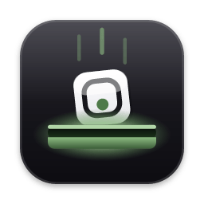
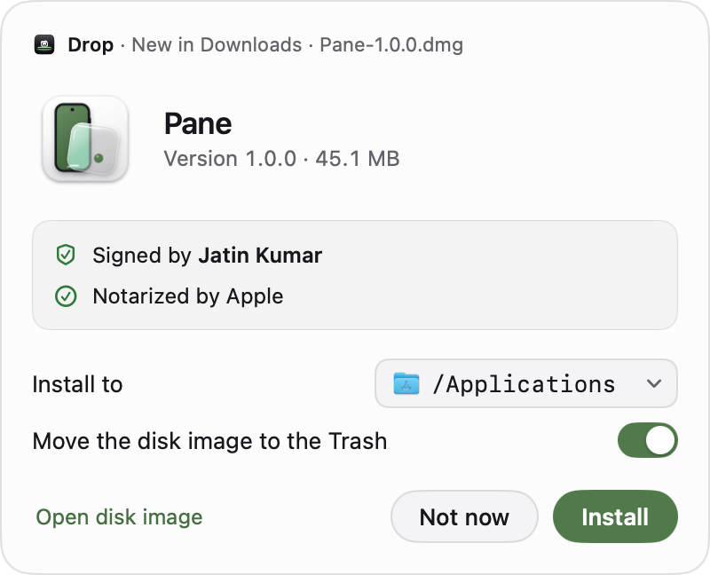
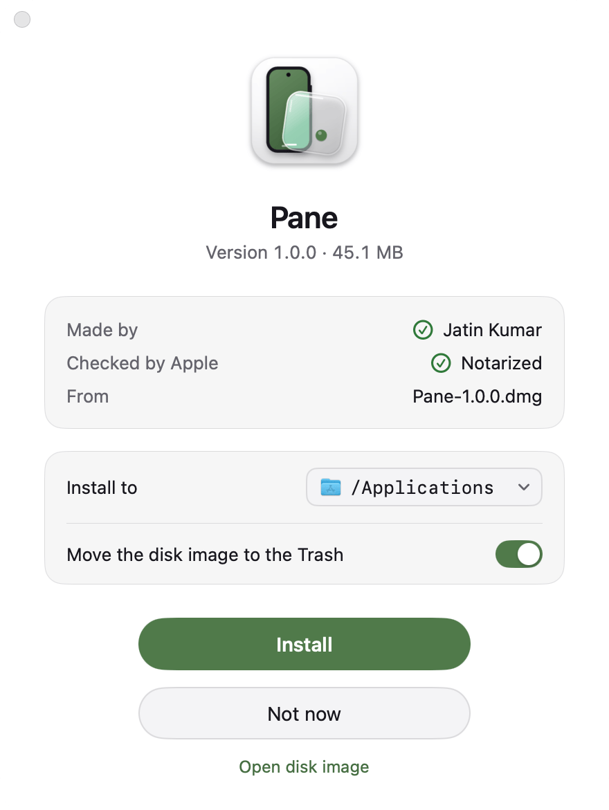
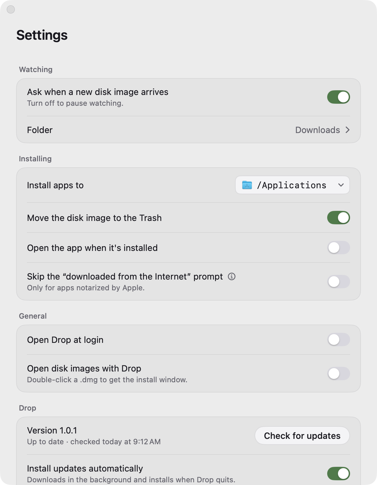

<div align="center">

  

  <h1>Drop: DMG Installer</h1>

  <p><b>Install Mac apps straight from a <code>.dmg</code>, without mounting it.</b></p>

  <p>
    When a disk image finishes downloading, Drop shows a small panel with the app, its version and who signed it.<br/>
    Click Install and the app is in Applications. No mounting, no dragging, no ejecting.
  </p>

<p>
  <a href="https://niduslabs.dev/drop"></a>
  <a href="https://github.com/niduslabs-dev/drop/releases/latest"></a>
  <a href="https://github.com/niduslabs-dev/drop/releases"></a>
  <a href="LICENSE"></a>
</p>

  <p>
    <a href="https://github.com/niduslabs-dev/drop/releases/latest/download/Drop.dmg"><b>Download</b></a>
    &nbsp;·&nbsp;
    <a href="#install"><b>Install</b></a>
    &nbsp;·&nbsp;
    <a href="#build-from-source"><b>Build from source</b></a>
    &nbsp;·&nbsp;
    <a href="#privacy"><b>Privacy</b></a>
  </p>

  <a href="docs/screenshots/popup-light.png">
    <picture>
      <source media="(prefers-color-scheme: dark)" srcset="docs/screenshots/popup-dark.png">
      
    </picture>
  </a>

  <p><sub>The panel for a new download in Downloads. Click to see it full size.</sub></p>

</div>

---

Drop keeps macOS's own safety checks. Installed apps carry the same "downloaded from the internet" record as after a Finder drag, so Gatekeeper still checks them when they first open.

---

## Features

### A new download

- **Watches one folder:** Downloads, or another folder you choose. When a `.dmg` finishes, a small panel slides in at the top right with the app's icon, version and signer.
- **One click:** Install puts the app in Applications. Not now leaves the disk image where it is, and Open disk image mounts it the usual way.
- **Never in your way:** the panel never takes focus from what you're doing.

### A double-click

- **Open disk images with Drop:** with this on, a `.dmg` you open in Finder gets Drop's install window instead of mounting.
- **Open With:** Drop is always in a disk image's Open With menu, even with the switch off.

<p align="center">
  <a href="docs/screenshots/window-light.png">
    <picture>
      <source media="(prefers-color-scheme: dark)" srcset="docs/screenshots/window-dark.png">
      
    </picture>
  </a>
  &nbsp;
  <a href="docs/screenshots/settings-light.png">
    <picture>
      <source media="(prefers-color-scheme: dark)" srcset="docs/screenshots/settings-dark.png">
      
    </picture>
  </a>
</p>
<p align="center"><sub>The install window a double-clicked disk image gets, and Settings.</sub></p>

### No mounting

- **Reads the disk image itself:** the UDIF container with every compression Apple's tools produce (zlib, bzip2, lzfse, lzma, ADC), GUID, Apple and MBR partition maps, and HFS+ and APFS.
- **A hidden fallback:** images it can't read (encrypted, sparse, unusual formats) are mounted hidden and installed the same way.
- **Licences and passwords:** Drop shows a disk image's licence before it installs, and asks for the password of an encrypted one.

### Safety

- **Before you install:** Drop shows who signed the app and whether Apple notarized it.
- **Damaged apps:** Drop refuses an app whose signature is broken or revoked.
- **Updates to an app you have:** Drop compares the developer with the copy you already have. If that copy is open, one press asks it to quit, then installs. Drop never forces it.
- **Gatekeeper still checks:** Drop keeps the quarantine record, so macOS checks the app when it first opens.

> [!NOTE]
> One setting changes the last point. "Skip the 'downloaded from the Internet' prompt" is off by default. Turned on, it skips that prompt only for apps Apple notarized and that pass Drop's check.

### Out of the way

- **No Dock or menu bar icon.** Open Drop again from Applications or Spotlight to see Settings.
- **Light at rest:** about 12 MB of memory after launch, and no CPU while it waits for a download.
- **Gentle in the background:** Drop prepares an app at low priority, and waits in Low Power Mode or when the Mac is hot.

### Settings

| Setting | Default | What it does |
|---|---|---|
| Ask when a new disk image arrives | On | Shows the panel for each new `.dmg`. Turn off to pause watching. |
| Folder | Downloads | The folder Drop watches. |
| Install apps to | `/Applications` | Or Applications in your home folder. |
| Move the disk image to the Trash | On | Once the app is installed. |
| Open the app when it's installed | Off | Opens the app as the panel closes. |
| Skip the "downloaded from the Internet" prompt | Off | Only for apps notarized by Apple. |
| Open Drop at login | Off | Starts Drop when you log in. |
| Open disk images with Drop | Off | Double-click a `.dmg` to get the install window. |
| Install updates automatically | On | Downloads in the background and installs when Drop quits. |

---

## Install

1. Download [`Drop.dmg`](https://github.com/niduslabs-dev/drop/releases/latest/download/Drop.dmg) from the latest release.
2. Open it and drag Drop to Applications.
3. Open Drop. A short welcome asks for access to Downloads, and offers to open disk images and start at login. Drop asks macOS for each only when you press its button.

Drop is signed with a Developer ID and notarized by Apple, so it opens with no extra steps.

> [!TIP]
> Once Drop is running, its own disk images work too. Open a newer `Drop-<version>.dmg` and Drop offers Check for updates instead of installing over itself.

---

## Updating

Drop updates itself with [Sparkle](https://sparkle-project.org). Once a day it checks the latest release on GitHub, downloads in the background and verifies the update's signature. It installs when Drop quits, or straight away if you choose Restart to update.

Turn off "Install updates automatically" in Settings and Drop asks before it downloads. Check for updates in Settings checks right away.

---

## Uninstalling

1. In Settings, turn off "Open disk images with Drop" and "Open Drop at login". Disk images then open with macOS's own DiskImageMounter again.
2. Click Quit Drop at the bottom of Settings.
3. Drag Drop from Applications to the Trash.

Drop leaves a few small files behind. Remove them too for a clean slate:

- `~/Library/Application Support/Drop` (the disk images it has already offered)
- `~/Library/Preferences/dev.niduslabs.drop.plist` (your settings)
- `~/Library/Caches/dev.niduslabs.drop` (update downloads)

---

## Build from source

Needs Xcode 27 or later on macOS 15 or later.

```sh
scripts/swift.sh build
scripts/fixtures-diskimage.sh && scripts/fixtures-hfsplus.sh && scripts/fixtures-apfs.sh   # test images, once
scripts/swift.sh test
scripts/swift.sh run dmg-inspect path/to/App.dmg
```

`scripts/swift.sh` runs `swift` with Homebrew's LLVM build settings removed, which otherwise break Xcode's toolchain. The fixture scripts build small disk images with `hdiutil` into `.build/fixtures/`. `scripts/build-app.sh` assembles `.build/Drop.app`, signed ad hoc.

---

## Requirements

- macOS 15 or later.
- A Mac with Apple silicon. Release builds are arm64 only.

---

## Privacy

Drop sends nothing anywhere. Its only network use is checking GitHub for its own updates, and macOS's own notarization check of the apps you install.

Drop isn't sandboxed: it writes apps to Applications and reads the folder it watches.

---

## Security

- **Signed and notarized:** every release is signed with a Developer ID and notarized by Apple, with the ticket stapled to the disk image.
- **Built in public:** releases are built and published on [GitHub Releases](https://github.com/niduslabs-dev/drop/releases) by a workflow, never from a laptop.
- **Signed updates:** Sparkle checks each update's EdDSA signature and the app's code signature before it installs.
- **Untrusted input:** every disk image is treated as untrusted. Every read is bounds-checked, so a damaged image fails cleanly.

Found a security issue? Email [support@niduslabs.dev](mailto:support@niduslabs.dev) rather than opening a public issue.

---

## Contributing

Not taking code contributions yet. Bug reports, especially disk images Drop can't read, are welcome as [issues](https://github.com/niduslabs-dev/drop/issues).

---

## License

[GPL-3.0](LICENSE). Copyright Nidus Labs.

---

## Support

Questions or problems: open an [issue](https://github.com/niduslabs-dev/drop/issues) or email [support@niduslabs.dev](mailto:support@niduslabs.dev).

---

<div align="center">
  <sub>A <a href="https://niduslabs.dev">Nidus Labs</a> app. <i>A home for little ideas.</i></sub>
</div>
